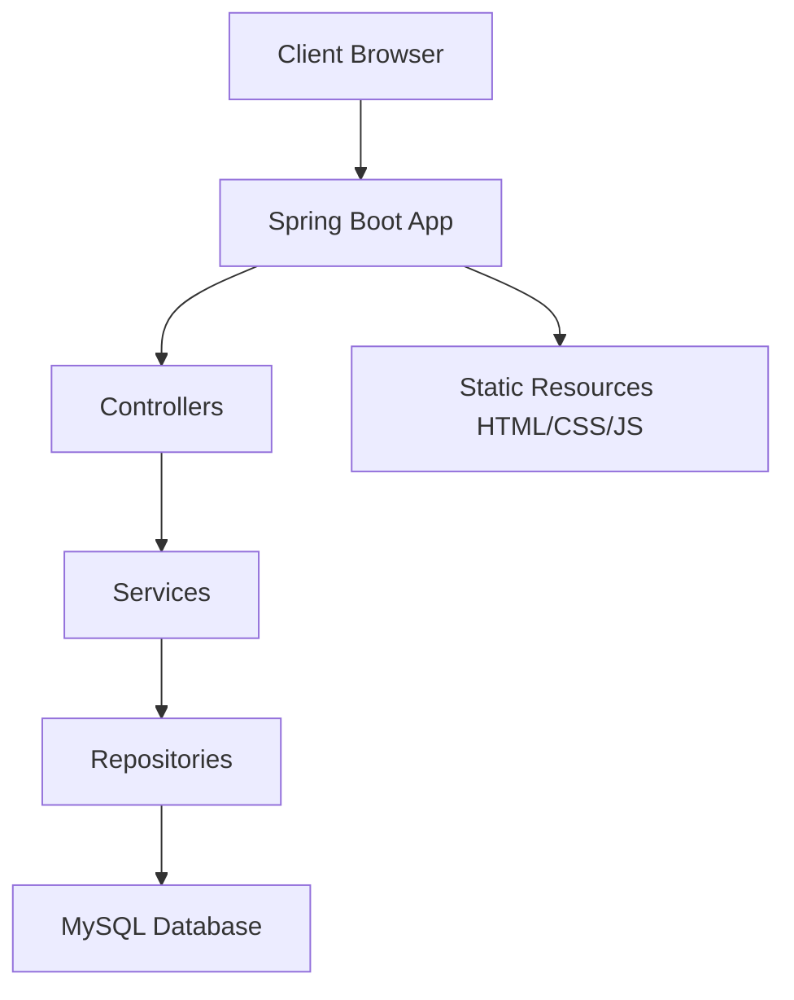

# Online Food Ordering System

A full-stack web application for online food ordering with customer and admin functionalities. Built with Spring Boot, MySQL, and vanilla HTML/CSS/JavaScript.

## Features

### Customer Features
- User registration and authentication (session-based)
- Browse menu with search, category filter, price sorting, and pagination
- View food details
- Add items to cart (database-backed, login required)
- Manage cart (update quantities, remove items)
- Checkout and place orders (Cash on Delivery only)
- View order history and order details
- Cancel orders while status is PLACED
- Track order status

### Admin Features
- Admin dashboard with statistics (total orders, orders by status, active food items, total sales)
- Manage food items (add, edit, toggle availability, soft delete)
- Manage categories (add, edit, soft delete)
- Manage orders (view all orders, filter by status, update order status)
- **Total sales** calculated as sum of total_amount for orders with status DELIVERED only

## Tech Stack

| Technology | Purpose |
|------------|---------|
| Java 21 | Programming Language |
| Spring Boot 3.x | Application Framework |
| Spring Security | Authentication & Authorization (Session-based) |
| Spring Data JPA + Hibernate | ORM & Data Access |
| MySQL 8.x | Database |
| Flyway | Database Migrations |
| Maven | Build Tool |
| Jakarta Bean Validation | Request Validation |
| springdoc-openapi | API Documentation (Swagger) |
| HTML/CSS/JavaScript | Frontend (Vanilla) |
| JUnit 5, Mockito | Testing |
| Testcontainers | Integration Testing |
| Docker & Docker Compose | Containerization |

## Architecture



## ER Diagram

```mermaid
erDiagram
    USERS ||--o| CARTS : has
    USERS ||--o{ ORDERS : places
    CARTS ||--o{ CART_ITEMS : contains
    CATEGORIES ||--o{ FOOD_ITEMS : contains
    FOOD_ITEMS ||--o{ CART_ITEMS : in
    FOOD_ITEMS ||--o{ ORDER_ITEMS : ordered
    ORDERS ||--o{ ORDER_ITEMS : contains
    
    USERS {
        bigint id PK
        varchar full_name
        varchar email UK
        varchar password_hash
        varchar role
        timestamp created_at
    }
    CATEGORIES {
        bigint id PK
        varchar name UK
        varchar description
        boolean active
    }
    FOOD_ITEMS {
        bigint id PK
        varchar name
        text description
        decimal price
        varchar image_url
        boolean available
        boolean active
        bigint category_id FK
    }
    CARTS {
        bigint id PK
        bigint user_id FK UK
        timestamp updated_at
    }
    CART_ITEMS {
        bigint id PK
        bigint cart_id FK
        bigint food_item_id FK
        int quantity
    }
    ORDERS {
        bigint id PK
        bigint user_id FK
        timestamp order_date
        varchar status
        text delivery_address
        varchar contact_number
        varchar delivery_instructions
        decimal subtotal
        decimal delivery_fee
        decimal total_amount
        varchar payment_method
        varchar payment_status
    }
    ORDER_ITEMS {
        bigint id PK
        bigint order_id FK
        bigint food_item_id FK
        varchar item_name
        decimal unit_price
        int quantity
        decimal line_total
    }
```

## Setup Instructions

### Prerequisites
- Java 21
- Maven 3.9+
- MySQL 8.x (or use Docker)

### Local Development Setup

1. Clone the repository
```bash
git clone <repository-url>
cd online-food-ordering-system
```

2. Create MySQL database
```sql
CREATE DATABASE food_ordering;
```

3. Copy environment variables
```bash
cp .env.example .env
```
Update `.env` with your database credentials.

4. Run the application
```bash
mvn spring-boot:run
```

The application will be available at `http://localhost:8080`

### Docker Setup

1. Build and run with Docker Compose
```bash
docker compose up --build
```

The application will be available at `http://localhost:8080`

## Environment Variables

| Variable | Description | Default |
|----------|-------------|---------|
| `DB_URL` | JDBC URL for MySQL | `jdbc:mysql://localhost:3306/food_ordering?useSSL=false&allowPublicKeyRetrieval=true&serverTimezone=UTC` |
| `DB_USERNAME` | Database username | `root` |
| `DB_PASSWORD` | Database password | `password` |
| `ADMIN_EMAIL` | Admin email (created on startup if not exists) | `admin@foodordering.com` |
| `ADMIN_PASSWORD` | Admin password (dev only) | `Admin@1234` |
| `SERVER_PORT` | Application port | `8080` |

**Note:** Never use default admin credentials in production!

## Default Admin Credentials (Development Only)
- Email: `admin@foodordering.com`
- Password: `Admin@1234`

## API Documentation
Swagger UI is available at: `http://localhost:8080/swagger-ui.html`

## Running Tests
```bash
mvn verify
```

This will run all tests and generate JaCoCo coverage report.

## Project Structure
```
src/
├── main/
│   ├── java/com/foodordering/
│   │   ├── config/          # Security, OpenAPI, DataInitializer
│   │   ├── controller/      # REST Controllers
│   │   ├── service/         # Business Logic
│   │   ├── repository/      # Data Access
│   │   ├── entity/          # JPA Entities
│   │   ├── dto/             # Request/Response DTOs
│   │   ├── mapper/          # Entity Mappers
│   │   └── exception/       # Exception Handling
│   └── resources/
│       ├── application.yml
│       ├── db/migration/    # Flyway Migrations
│       └── static/          # Frontend files
└── test/
    └── java/com/foodordering/
        ├── service/
        ├── controller/
        └── repository/
```

## Order Status Flow
`PLACED → CONFIRMED → PREPARING → OUT_FOR_DELIVERY → DELIVERED` or `CANCELLED`

**Cancellation Rules:**
- Customer can cancel only when status is PLACED
- Admin can cancel when status is PLACED or CONFIRMED

## Security
- Session-based authentication
- BCrypt password hashing
- CSRF protection enabled (X-XSRF-TOKEN header required for POST/PUT/PATCH/DELETE)
- Role-based access control (CUSTOMER, ADMIN)
- Password requirements: minimum 8 characters, at least one letter and one digit
- Generic login error messages
- Backend authorization enforced for all admin endpoints

## Money Handling
All monetary values use `BigDecimal` with proper scale (2) and `RoundingMode.HALF_UP`.

## Future Improvements
- Profile page for users
- Image upload functionality
- Order status auto-refresh (polling)
- Delivery fee configuration
- Admin order search by ID
- Email notifications
- Online payment integration
- Order rating and reviews

## Screenshots
Place screenshots in `docs/screenshots/` directory.
